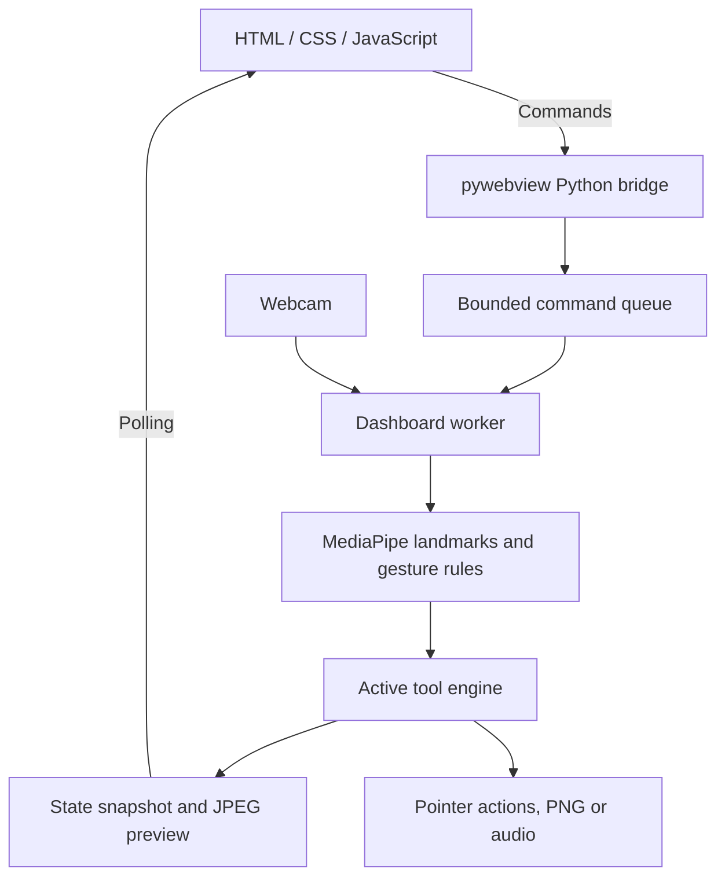

# HandFrame Studio — Technical Overview

[← Download, installation and user guide](README.md)

**Version:** 1.0.0 · **Platform:** Windows x64 · **Developer:** Pooya Haji Sadeghi

This document describes the implementation behind HandFrame Studio. This repository distributes the installer and documentation; source paths below describe the internal project layout, not files available in this public repository. End users do not need Python or a development environment.

## Architecture

HandFrame Studio is a local desktop application with three main layers:

| Layer | Responsibility |
| --- | --- |
| HTML/CSS/JavaScript dashboard | Pages, controls, device settings, language selection, previews and tool status. |
| pywebview desktop bridge | Hosts the dashboard in a native window and exposes Python commands, state snapshots and native save dialogs. Windows uses the Edge Chromium/WebView2 backend. |
| Python processing engines | Camera acquisition, hand landmarks, gesture logic, puzzles, pointer actions, drawing and audio synthesis. |



### State and device lifecycle

- The dashboard worker serializes tool commands and normal processing updates. Its command queue holds up to **100 commands**; a bridge call waits up to **15 seconds** for its result.
- The worker targets a **50 ms update interval**, subject to camera and inference latency. This is a scheduling target, not a guaranteed frame rate.
- JavaScript polls snapshots every **100 ms**. Preview images are JPEG-encoded, Base64-wrapped data URLs; this is not a WebRTC streaming pipeline.
- Only the active tool owns the camera. Switching tools releases the previous camera, detector, audio stream and mouse listener as applicable.
- Audio rendering runs separately through a PortAudio callback. A dedicated keyboard listener handles the F8 mouse-control toggle without waiting for dashboard polling.
- Unsaved drawing or audio state triggers confirmation before leaving the tool. Native save dialogs select output paths.

## Computer vision and gesture recognition

### Camera processing

OpenCV reads webcam frames and mirrors them horizontally. Frames are converted from BGR to RGB before being passed to **MediaPipe Hands**. The dashboard uses up to two hands for Puzzle and Music, and one hand for Mouse and Drawing.

MediaPipe supplies the learned hand-landmark detector. The application then applies geometric rules and state machines to those landmarks; it does **not** train a separate gesture-classification neural network.

### Scale-normalized pinch detection

A pinch is measured using the distance between fingertips relative to palm width:

```text
pinch ratio = distance(thumb tip, index tip)
              / max(distance(index MCP, little-finger MCP), 1 pixel)
```

Normalizing by palm width makes the threshold less dependent on hand size in the camera image. Different tools use separate close/open thresholds, timing checks and rearming states. This hysteresis reduces repeated transitions when the fingers are near a threshold.

For example, puzzle tile selection uses a ratio below **0.35**, while release requires a ratio above **0.50** sustained for **0.15 seconds**. The frame-creation pinch state uses its own thresholds.

Finger extension is estimated by comparing fingertip-to-wrist distance with the corresponding proximal landmark-to-wrist distance. This is a geometric approximation and can become unreliable with strong perspective, occlusion or unusual hand poses.

### Persistent hand association

The internal `HandTracker` associates wrist positions between frames to maintain temporary hand IDs. With at most two detections, it checks possible assignments and chooses the lowest-cost valid association. Stale tracks expire after **1.5 seconds**.

These IDs support drag ownership and musical roles. They are temporary tracking IDs, not biometric identities or a guarantee against identity switches when hands cross.

## Tool algorithms

### Photo Puzzle

1. A frame controller moves through ready, drawing and wait-for-release states.
2. Pinching both hands starts frame construction. Rectangle coordinates are smoothed as the hands move; opening the fingers freezes the region.
3. After a **five-second countdown**, the region is captured and divided into a **3×3, 4×4 or 5×5** grid.
4. Tile order is shuffled and explicitly prevented from starting in the solved order.
5. An open-then-pinch gesture selects a tile. The source tile and hand ID remain associated while dragging.
6. A confirmed release swaps the source and target tiles. Releasing outside the board cancels placement.
7. If the owning hand disappears for **one second**, the drag is cancelled without swapping tiles.

The original capture remains available as a reference. The interface reports correct tiles, moves, elapsed time and score. White hand skeletons are drawn after the puzzle overlay so they remain visible.

### Mouse Control

PyAutoGUI performs operating-system pointer actions. Gesture selection includes:

| Gesture / method | Result |
| --- | --- |
| Index fingertip position | Pointer movement within a mapped active camera region. |
| Confirmed index-and-middle V sign | One left click per confirmed pose and release cycle. |
| Thumb-to-middle pinch | Right click, with priority over left-pinch actions. |
| Thumb-to-index pinch held for 0.40 seconds | Begin left-button dragging; opening releases it. |
| Three-finger scroll pose with vertical movement | Scroll in discrete steps. |
| F8 through pynput | Enable or disable pointer control while Mouse Control is active. |

Movement uses time-based exponential smoothing. Rearming, confirmation delays and mutually exclusive scroll/click states reduce accidental actions. Tracking loss cancels mouse interaction after **0.40 seconds**, releasing a held drag. PyAutoGUI's fail-safe remains enabled.

### Drawing

A Pillow image stores the drawing independently of the camera preview. A single raised index finger with the other fingers folded activates drawing. Finger coordinates are mapped into the virtual drawing board.

The drawing model manages strokes, brush size, colors, erasing, undo history and dirty/saved state. Hovering over the camera-view palette for **0.55 seconds** selects a color. Tracking loss ends the stroke so reappearing hands do not draw a line across missing frames.

The exported **PNG** contains the drawing, not the live hand skeleton or dashboard controls. Saves use a temporary file followed by replacement to protect an existing destination if writing fails.

### Music

NumPy generates the note and drum sound bank locally. The sound engine uses synthesized signals rather than downloaded audio samples.

- **Notes:** C4, D4, E4, F4, G4, A4, B4 and C5.
- **Presets:** Piano, Warm Synth and Music Box.
- **Drums:** Kick, Snare, Hi-hat and Clap.
- **Output:** mono, **44.1 kHz**, with **512-sample** callback blocks.
- **Mixing:** up to 32 voices, with nonlinear output limiting.
- **Recording:** preallocated buffer, maximum **300 seconds**, exported as 16-bit PCM WAV.

The controller initially assigns melody/drum roles using camera position and available roles, then retains those roles with temporary hand IDs. Free Play uses confirmed pinch/finger transitions. Groove uses an original 16-step pattern and a scale-based arpeggio.

Sequencer timing follows the audio sample clock rather than video frame timing. This separates rhythmic scheduling from fluctuations in camera processing, although real-time performance still depends on device and system load.

## Libraries and technologies

The following constraints come from the project's dependency specification. They are not a claim that every dependency has an exact pinned version.

| Dependency | Declared version / range | Role |
| --- | --- | --- |
| Python | Windows build scripts require 64-bit Python 3.10 | Application runtime and packaging environment. |
| NumPy | `<2` | Numerical operations, sound-bank generation and audio mixing. |
| MediaPipe | `0.10.21` | Hand landmarks through the Hands Solutions API. |
| opencv-contrib-python | `4.11.0.86` | Camera capture, frame transformations, overlays and JPEG previews. |
| Pillow | `>=10,<13` | Drawing model, images, fonts and PNG export. |
| PyAutoGUI | `0.9.54` | Pointer movement, clicks, dragging and scrolling. |
| pynput | `>=1.7.7,<2` | Keyboard listener for the F8 toggle. |
| sounddevice | `>=0.5.3,<0.6` | PortAudio output stream and audio device enumeration. |
| pywebview | `6.0` | Desktop window, Python–JavaScript bridge and native dialogs. |
| Microsoft Edge WebView2 | Evergreen Runtime | Windows dashboard rendering prerequisite. |
| PyInstaller | `6.22.0` in the build requirements | Bundles the interpreter, modules and assets into a portable application. |
| NSIS | Portable fallback pinned to `3.11`; an installed compiler may also be used | Modern UI 2 setup wizard and native uninstaller. |
| Windows PowerShell | System-provided | Prerequisite checks and conditional WebView2 installation during Setup. |

Supporting Python standard-library modules include `queue`, `threading`, `concurrent.futures`, `dataclasses`, `logging`, `wave`, `json` and `pathlib`. pywebview also brings Windows interoperability dependencies such as pythonnet.

## Internal project organization

These paths are an architectural reference to the development project, not public source-download instructions.

| Internal path | Responsibility |
| --- | --- |
| `main.py` | Dashboard/tool entrypoint and packaged self-check routing. |
| `src/handframe/core/` | Resource paths, logging, cleanup, fonts, localization, preferences and prerequisite checks. |
| `src/handframe/desktop/` | Dashboard bridge, worker service and legacy launcher. |
| `src/handframe/tools/puzzle.py` | Rectangle state machine, hand tracking and puzzle logic. |
| `src/handframe/tools/mouse.py` | Pointer gesture state machine. |
| `src/handframe/tools/drawing.py` | Canvas model and drawing gestures. |
| `src/handframe/tools/music/` | Gesture controller, synthesis, sequencing and recording. |
| `ui/` | Dashboard HTML, CSS, JavaScript, localization and bundled assets. |
| `installer/nsis/` | Wizard script, artwork and prerequisite handling. |
| `scripts/` | Portable, installer and release build automation. |

## Packaging and distribution

**PyInstaller** produces an application folder containing `HandFrameStudio.exe` and `_internal`. The interpreter, Python modules and required assets travel with that folder; end users do not install Python.

**NSIS Modern UI 2** wraps the application in a setup wizard with language selection, an optional desktop shortcut, a chosen install directory, progress/details, and a final Launch option. Installation is per user by default.

Setup checks the Evergreen WebView2 registry entries. If the Runtime is absent, it downloads Microsoft's bootstrapper over HTTPS, validates its Authenticode signature and Microsoft signer, then invokes it with `/silent /install`. Download percentage is shown for the bootstrapper; the subsequent Runtime installation is a waiting stage rather than an exact overall download percentage.

The build tooling supports optional certificate-based signing. Support for signing does not mean the published installer is signed; that requires a valid code-signing certificate configured by the developer.

## Local processing and files

- Camera frames, landmark processing, drawing and audio synthesis run locally on the user's computer; no cloud inference service is used by these tool engines.
- The dashboard is served locally for pywebview. This is not a hosted web application or public backend API.
- Setup may contact Microsoft when WebView2 is missing. Opening the developer profile or help links launches the system browser.
- Language preference: `%LOCALAPPDATA%\HandFrame\preferences.json`.
- Application logs: `%LOCALAPPDATA%\HandFrame\logs\handframe.log`.
- PNG and WAV export locations are selected by the user.

## Limitations

Hand tracking depends on lighting, webcam quality, framing, occlusion and processing speed. Gesture thresholds and time filters reduce unintended actions but do not eliminate them. Temporary hand association can fail during crossings or rapid motion. GUI preview rates are separate from camera capture and audio timing; no fixed FPS or latency is guaranteed.

[Download and user guide →](README.md)

**Developed by Pooya Haji Sadeghi.**
